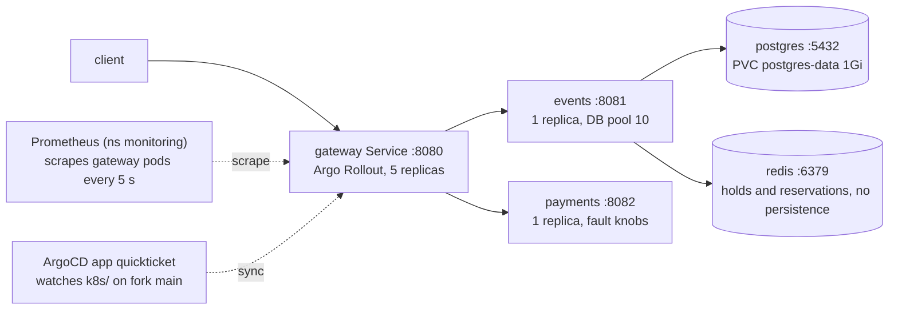

# QuickTicket SRE handbook

Kirill Fadeev, ki.fadeev@innopolis.university. State as of 2026-10-11, cluster `k3d-quickticket`. Every number here was measured in Labs 4 to 10; the lab that measured it is named in brackets.

## 1. Architecture



- Everything a user does goes through gateway. Reads (`GET /events`) need events and Postgres. A purchase needs events, Redis (`/reserve`), payments and Postgres (`/pay` then confirm).
- All five services run with `requests 50m/64Mi`, `limits 200m/256Mi`. Gateway has 5 replicas; events, payments, Postgres and Redis have one each, so each of them is a single point of failure.
- Readiness of gateway and events is shallow (`/metrics`), liveness too. `/health` checks dependencies and is only for people and dashboards. Putting probes on `/health` turned a Redis outage into a 73 s outage of reads as well [Lab 8].
- Postgres keeps its data on a PVC with `strategy: Recreate`, so a pod restart costs about 2 s and no rows [Lab 9]. Redis keeps reservations and the `event:N:held` counters in memory only.
- Known defect: events increments `event:N:held` on every reservation and never decrements it, so every paid ticket is counted twice and an event "sells out" at half its capacity. Until it is fixed, `redis-cli DEL event:N:held` is the workaround [Labs 8, 9, 10].

## 2. How to deploy

1. Change code under `app/` on a branch, open a PR into `main` of the fork, merge.
2. CI (`.github/workflows/ci.yml`, about 40 to 60 s) builds the three images, pushes them to `ghcr.io/kortezz12/quickticket-<svc>:<sha>`, rewrites the tags in `k8s/*.yaml` and pushes a `ci:` commit to `main`. Commits starting with `ci:` do not trigger CI again.
3. ArgoCD polls the repository every 180 s and applies `k8s/`. Commit to running pods took 199 to 286 s for the three code changes measured [Lab 10, DORA].
4. The gateway Rollout runs the canary: 20 %, pause 20 s, AnalysisRun `gateway-error-rate` (5xx ratio of the canary pods below 5 %, three 20 s measurements after a 60 s delay), 50 %, pause 20 s, 100 %. A failed analysis or 60 s without progress aborts the rollout by itself; a bad canary was aborted 107.6 s after apply [Lab 7].
5. Watch it: `kubectl argo rollouts get rollout gateway --watch`.

Rolling back:

| Situation | Command | Time to users safe |
|---|---|---|
| Canary in progress looks wrong | `kubectl argo rollouts abort gateway` | 0.6 s to leave the Service, 9.3 s to full stable capacity [Lab 7] |
| Bad version already at 100 % | `git revert <sha> && git push` | 189.8 s, 175.7 s of it ArgoCD polling [Lab 5] |

After an `abort`, also revert in Git, otherwise the next sync starts the same canary again.

**Current caveat.** ArgoCD auto-sync is suspended since Lab 7, and the app is `OutOfSync` on 6 objects because the cluster runs the Lab 7 to 9 manifests while fork `main` still has the Lab 5 Deployment. Until those branches are merged, deploy with `kubectl apply -f k8s/<file>` from the matching lab branch, then re-enable self-heal: `kubectl patch application quickticket -n argocd --type merge -p '{"spec":{"syncPolicy":{"automated":{"selfHeal":true}}}}'`.

## 3. Monitoring

Prometheus has no persistent volume and loses its history on every restart, including a WSL restart. For anything older than the last restart, use the lab capture files.

Open it with `kubectl -n monitoring port-forward deploy/prometheus 9090` (one person, one pod, fine for reading; never for load).

| Question | Query |
|---|---|
| Are users getting errors? | `sum(rate(gateway_requests_total{status=~"5.."}[5m])) / sum(rate(gateway_requests_total[5m]))` |
| Which endpoint fails? | `sum by (path,status) (rate(gateway_requests_total{status=~"5.."}[5m]))` |
| Is it slow? | `histogram_quantile(0.99, sum by (le,path) (rate(gateway_request_duration_seconds_bucket{path!="/health"}[5m])))` |
| Latency SLO | `sum(rate(gateway_request_duration_seconds_bucket{le="0.5"}[5m])) / sum(rate(gateway_request_duration_seconds_count[5m]))` |
| Is load spread over replicas? | `sum by (pod) (rate(gateway_requests_total[1m]))` |
| Canary vs stable | the same queries with `{rs_hash="<hash>"}` |
| Is a pod CPU-bound? | `kubectl top pods`, then `kubectl exec <pod> -- cat /sys/fs/cgroup/cpu.stat` (`nr_throttled`) |

SLOs: availability 99.5 % of gateway requests without 5xx, latency 95 % under 500 ms (both over 7 days, Lab 3). Only gateway is scraped. events, payments, Postgres and Redis have no metrics in Prometheus, so a slow dependency shows up only as gateway latency.

## 4. Incident response

Alerts (Grafana, Lab 6): **High Error Rate**, 5xx above 5 % for 2 min, critical; **SLO Burn Rate**, 30 min burn above 6x, warning.

1. **Scope.** Which path fails: the "Which endpoint fails?" query. 5xx on `/events` means events or Postgres; 5xx on `/events/{id}/reserve` means events, Redis or the DB pool; 5xx on `/reserve/{id}/pay` means payments.
2. **State.** `kubectl get pods -o wide` (restarts, Ready), `kubectl get rollout gateway`, `kubectl get events --sort-by=.lastTimestamp | tail -20`.
3. **Dependencies from inside the cluster.** `kubectl exec deploy/payments -- python -c 'import urllib.request;print(urllib.request.urlopen("http://events:8081/health",timeout=3).read())'`; payments: `kubectl exec deploy/payments -- python -c '...8082/health...'` shows `failure_rate` and `latency_ms`.
4. **Logs.** `kubectl logs deploy/events --since=10m | grep -E "PoolError|Traceback|Redis"`, `kubectl logs -l app=gateway --since=10m --prefix | grep -i error`.

| Cause | How it looks | Fix |
|---|---|---|
| Bad gateway version | errors only on canary `rs_hash` | `kubectl argo rollouts abort gateway`, then `git revert` |
| Payments failing or slow | 5xx or 504 on `/pay` only | set `PAYMENT_FAILURE_RATE=0.0`, `PAYMENT_LATENCY_MS=0` |
| Redis down | `/reserve` 500, `/events` still 200 | `kubectl rollout restart deploy/redis`, then `DEL event:N:held` if counters are wrong |
| events CPU-bound or DB pool exhausted | p99 rises with load, `PoolError` in events logs | `kubectl scale deploy/events --replicas=2` (Lab 10 Task 2) |
| Postgres restarted | `/events` 502 for about 20 s | wait; events reconnects lazily (about 20 s, Lab 9) |
| Event "sold out" too early | 409 on `/reserve` while `/events` shows tickets | `redis-cli DEL event:N:held` (the double-count defect) |

Escalation: if not mitigated in 10 minutes, escalate to the course TA. Write a blameless postmortem for anything that pages (template in Lab 6).

## 5. Backup and restore

The backup CronJob `k8s/backup-cronjob.yaml` (Lab 9 bonus) dumps the database every 5 minutes into the `postgres-backups` PVC and keeps the 5 newest dumps, so RPO is at most 5 minutes. **It is not running right now** (no CronJob and no backup PVC in the cluster on 2026-10-11): re-apply it first.

```bash
kubectl apply -f labs/lab9/backup-storage.yaml      # PVC postgres-backups
kubectl apply -f k8s/backup-cronjob.yaml
kubectl create job --from=cronjob/postgres-backup backup-now   # take one now
kubectl logs job/backup-now                                    # "wrote quickticket_<UTC>.dump"
```

Manual backup and restore:

```bash
P=$(kubectl get pod -l app=postgres -o name)
kubectl exec $P -- pg_dump -U quickticket -Fc quickticket > quickticket.dump
kubectl cp quickticket.dump ${P#pod/}:/tmp/backup.dump
kubectl exec $P -- pg_restore -U quickticket -d quickticket --clean --if-exists /tmp/backup.dump
kubectl exec $P -- psql -U quickticket -d quickticket -c 'SELECT count(*) FROM orders'
```

Measured: dropping `orders` gave 502 on reads for 17.5 s, `pg_restore` took 0.4 s [Lab 9]. Losing the Postgres pod costs 2.3 s for the DB and about 24 s end to end with the PVC, against 26 lost orders without it [Lab 9]. After any restore, run `alembic current` (expect `43b43772c5f3`) and check counts against the last known values. A restore that was never tested is not a backup: restore the newest CronJob dump into a scratch database once a week.
